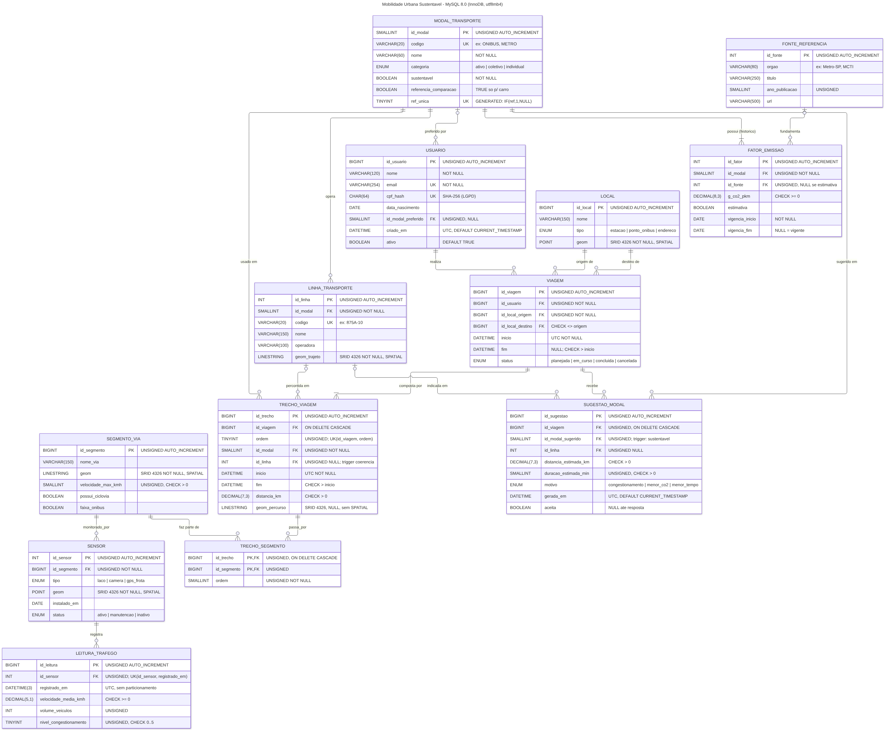

# Projeto A3 – Banco de Dados: Mobilidade Urbana Sustentável

Solução em **MySQL 8.0** (InnoDB, utf8mb4) para monitorar tráfego em tempo real, histórico de deslocamentos, sugestão de modais sustentáveis e cálculo de emissões de CO₂e — tema *Mobilidade Urbana Sustentável* (São Paulo).

## Como executar

### Opção A – Docker Compose (recomendado)

```bash
docker compose up -d
# aguarde o healthcheck
docker compose exec mysql mysqladmin ping -h127.0.0.1 -uroot -prootpass

# Script único (do zero):
docker compose exec -T mysql mysql -uroot -prootpass < sql/script_completo.sql

# Ou scripts numerados:
MYSQL_HOST=127.0.0.1 MYSQL_PWD=rootpass ./scripts/run_all.sh
```

### Opção B – MySQL 8 local

```bash
# regenerar o script único (se alterou os numerados)
./scripts/build_script_completo.sh

# caminho completo:
mysql -h127.0.0.1 -uroot -prootpass < sql/script_completo.sql

# ou numerados em ordem:
MYSQL_PWD=rootpass ./scripts/run_all.sh
```

Senha de root usada nos exemplos acadêmicos: `rootpass`.  
Usuários de aplicação (script `05`): `app_mobilidade` / `analista_mobilidade` / `admin_mobilidade` (senhas no próprio script — trocar em produção).

Saída real de uma execução nesta VM: [`docs/execucao.txt`](docs/execucao.txt).

## Estrutura do repositório

```
sql/
  01_schema.sql          # DATABASE + 13 tabelas + PK/FK/UNIQUE/CHECK + índices (incl. SPATIAL)
  02_views.sql           # CO₂ por trecho/viagem/usuário/modal/linha + economia vs carro
  03_triggers.sql        # Sobreposição de fator, coerência modal×linha, sugestão sustentável
  04_procedures.sql      # sp_registrar_viagem, sp_gerar_sugestao_sustentavel, EVENT limpeza
  05_security.sql        # roles (app / analista / admin) + users + GRANTs
  06_seed.sql            # GERADO: GTFS/OSM reais + fatores + simulações LGPD
  07_relatorios.sql      # consultas de relatório
  08_testes.sql          # provas de rejeição (CHECK/FK/trigger) + rollback de transação
  09_monitoramento.sql   # performance_schema / sys (administração)
  script_completo.sql    # GERADO – não editar à mão
scripts/
  importar_dados_reais.py    # baixa GTFS/OSM e regenera 06_seed.sql (embute Olho Vivo)
  coletar_posicoes.py        # coleta GET /Posicao (token SPTRANS_OLHOVIVO_TOKEN)
  processar_olhovivo.py      # deriva sensor/leitura → fontes/olhovivo/
  build_script_completo.sh   # concatena 01–08 → script_completo.sql
  run_all.sh                 # executa 01–08 em ordem
  backup_restore_exemplo.sh  # mysqldump + notas de PITR via binlog
fontes/olhovivo/             # SQL/método/resumo + tar bruto da coleta 19/11/2026
data/cache/                  # cache de download (zip GTFS não versionado)
docs/
.env.example                 # SPTRANS_OLHOVIVO_TOKEN= (sem valor)

  er.png / er.mmd        # modelo ER aprovado (13 tabelas, 3FN)
  normalizacao.md        # dicionário, restrições e decisões MySQL
  enunciado.md           # enunciado do projeto
  execucao.txt           # console real da execução
docker-compose.yml
```

### Script completo (`sql/script_completo.sql`)

A **fonte da verdade** são os arquivos numerados `01`–`08`. O script único é gerado por:

```bash
./scripts/build_script_completo.sh
```

Ele prefixa `DROP DATABASE IF EXISTS mobilidade_urbana;` e concatena os numerados na ordem. Sempre regenere após editar qualquer `0x_*.sql`.

## Justificativa do SGBD (MySQL 8.0)

- **InnoDB**: transações ACID e FKs reais (critério de avaliação).
- **CHECK** efetivo desde 8.0.16.
- Tipos espaciais nativos (`POINT`/`LINESTRING`, SRID 4326, `SPATIAL INDEX`) e funções geodésicas.
- Window functions/CTEs, triggers, procedures, EVENT scheduler, `CREATE ROLE`.
- Gratuito e amplamente usado no mercado/curso — viável técnica e financeiramente.

Detalhes e decisões (sem particionar `leitura_trafego` para manter FK, coluna gerada `ref_unica`, `axis-order=long-lat`, CHECKs sem ação referencial em colunas FK): ver [`docs/normalizacao.md`](docs/normalizacao.md).

## Modelo ER



Fonte Mermaid: [`docs/er.mmd`](docs/er.mmd). **13 tabelas** em 3FN. Valores de CO₂/economia **não são armazenados** — calculados em views com o fator vigente na data do trecho.

## Origem dos dados

O seed `sql/06_seed.sql` é **gerado** por `scripts/importar_dados_reais.py` (reprodutível; o SQL commitado permite rodar offline). Acesso registrado na geração (ver cabeçalho do seed e `data/cache/seed_provenance.json`).

**No seed atual**

| Tabela | No seed | Fonte / observação | Licença / URL |
|---|---|---|---|
| `linha_transporte` (+ `geom_trajeto`) | **Real** (subconjunto) | GTFS SPTrans via espelho [Mobility Database mdb-8](https://mobilitydatabase.org/feeds/gtfs/mdb-8) (`mdb-latest` no GCS). O feed inclui **Metrô** (`route_type=1`) e **CPTM** (`route_type=2`). Produtor oficial exige cadastro: [SPTrans Desenvolvedores](https://www.sptrans.com.br/desenvolvedores/). Subconjunto: Metrô L1–L5, CPTM L07–L09, 10 linhas de ônibus com trips no feed. | Termos SPTrans / espelho MDB; shapes GTFS |
| `local` | **Real** (subconjunto) | `stops.txt` do mesmo GTFS (estações/paradas com coordenadas reais) | Idem |
| `segmento_via` | **Real** | OpenStreetMap (Nominatim + API 0.6 `way/full`) nos corredores Paulista, Rebouças, Consolação, 23 de Maio, Marginal Pinheiros (`maxspeed`, ciclovia, faixa de ônibus quando tagueados) | [ODbL 1.0](https://www.openstreetmap.org/copyright) — © OpenStreetMap contributors |
| `fator_emissao` / `fonte_referencia` | **Real** | Valores e URLs de [`docs/normalizacao.md`](docs/normalizacao.md) (Metrô-SP, MCTI/SIRENE, UK DESNZ) | Conforme cada publicação |
| `modal_transporte` | Catálogo | Domínio interno do produto | — |
| `sensor` / `leitura_trafego` | **Real** (59 leituras) | API [Olho Vivo SPTrans v2.1](https://api.olhovivo.sptrans.com.br/v2.1) `GET /Posicao`, janela **19/11/2026 08:33–09:17** America/Sao_Paulo. Sensores virtuais `gps_frota` nos eixos OSM; ids **9 e 10 inativos** (Marginal Pinheiros sem cobertura de ônibus SPTrans). Caveats: velocidade de **ônibus** (inclui paradas); `volume_veiculos` = nº de ônibus (não todo o tráfego); `nivel_congestionamento` **derivado** (regra do projeto). Método: [`fontes/olhovivo/METODO.md`](fontes/olhovivo/METODO.md); SQL: `fontes/olhovivo/leitura_trafego_real.sql`. Token só em `SPTRANS_OLHOVIVO_TOKEN` (nunca commitado). | Termos SPTrans Desenvolvedores |
| `usuario` / `viagem` / `trecho_viagem` / `trecho_segmento` / `sugestao_modal` | **Simulado** | Pessoas fictícias (LGPD). Viagens/sugestões ancoradas em locais/linhas/segmentos reais; `distancia_km` por haversine entre coordenadas reais. `sugestao_modal` também pode ser gerada por `sp_gerar_sugestao_sustentavel`. | — |

Regenerar o seed de rede (requer rede; **reusa** Olho Vivo já processado):

```bash
python3 scripts/importar_dados_reais.py   # embute fontes/olhovivo/leitura_trafego_real.sql
./scripts/build_script_completo.sh
```

Recoletar Olho Vivo (token obrigatório; brutos em `fontes/olhovivo/`):

```bash
export SPTRANS_OLHOVIVO_TOKEN=...   # ver .env.example — nunca versionar
python3 scripts/coletar_posicoes.py 15 30 fontes/olhovivo/raw
python3 scripts/processar_olhovivo.py sql/06_seed.sql fontes/olhovivo/raw 5
```

**Ingestão em produção (frequência)**

| Tabela | Como ingerir / frequência |
|---|---|
| `modal_transporte` | Carga inicial + sob demanda |
| `fonte_referencia` / `fator_emissao` | ETL quando sair inventário (anual / sob demanda) |
| `local` / `linha_transporte` | Batch diário do GTFS (SPTrans + Metrô/CPTM no feed) |
| `segmento_via` | Batch semanal/mensal OSM / GeoSampa |
| `sensor` | Cadastro CET-SP / sensores virtuais Olho Vivo (`gps_frota`) |
| `leitura_trafego` | Quase tempo real: Olho Vivo SPTrans (`SPTRANS_OLHOVIVO_TOKEN`) e/ou CET-SP |
| `usuario` / `viagem` / `trecho_viagem` | Tempo real via app (+ GPS) |
| `trecho_segmento` | Near-real-time (matching GPS × malha) |
| `sugestao_modal` | Sob demanda (`sp_gerar_sugestao_sustentavel`) |

## Segurança, backup e monitoramento

- Roles de menor privilégio: `role_app`, `role_analista`, `role_admin_dados` (`05_security.sql`).
- Backup lógico: `./scripts/backup_restore_exemplo.sh` (`mysqldump --single-transaction --routines --triggers --events`).
- Point-in-time: anotar `SHOW BINARY LOG STATUS` no dump e aplicar `mysqlbinlog` até `--stop-datetime` (binlog habilitado no `docker-compose.yml`).
- Monitoramento: `sql/09_monitoramento.sql` (performance_schema / sys).

## Desvios do modelo aprovado

Nenhum desvio estrutural das 13 tabelas. Complementos documentados (não alteram a 3FN do modelo):

- Views extras de relatório (`vw_emissao_usuario`, `vw_emissao_modal`, `vw_emissao_linha`, `vw_economia_vs_carro`, `vw_taxa_aceitacao_sugestao`) além das previstas no texto de normalização.
- Trigger adicional: viagem `concluida` exige ≥1 trecho e `fim` preenchido.
- Functions auxiliares `fn_fator_vigente` / `fn_co2_estimado_g`.
- Script `09_monitoramento.sql` e usuários/roles de demonstração (fora do DER).
